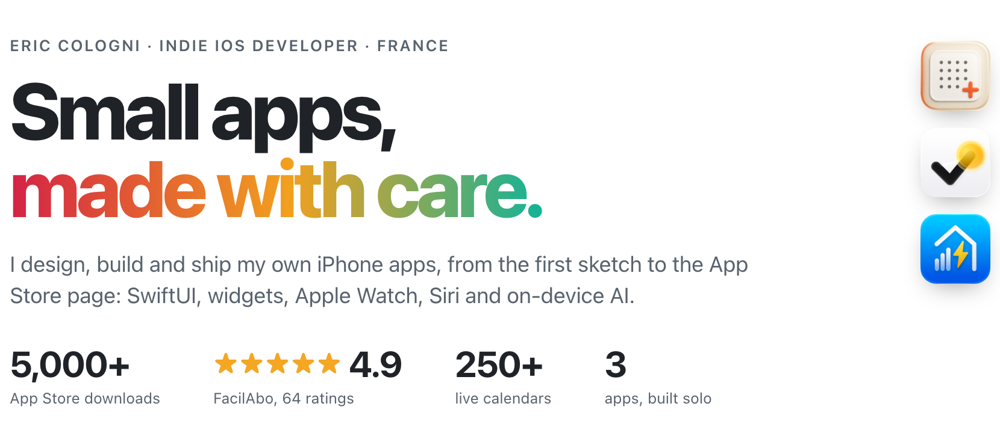
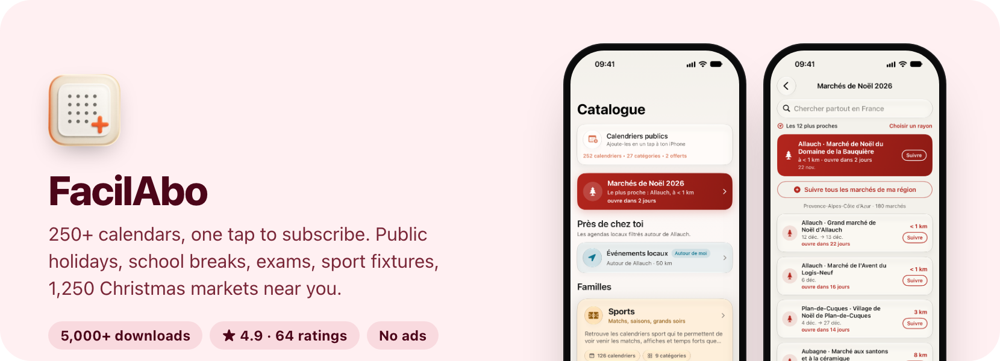
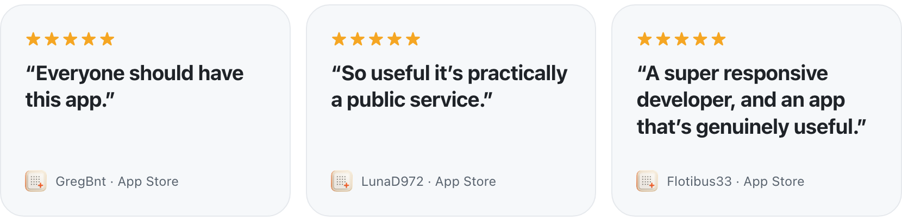
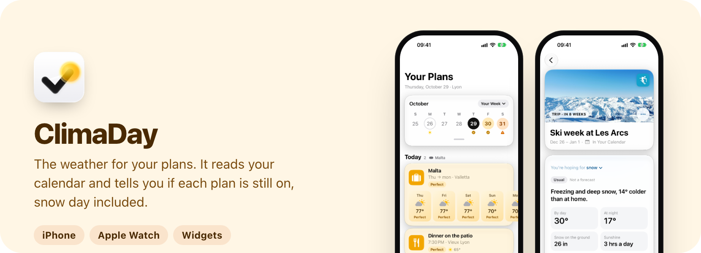
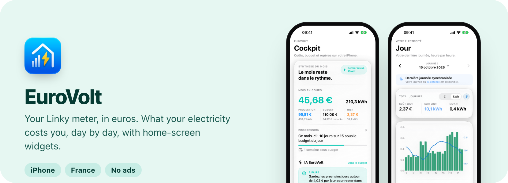
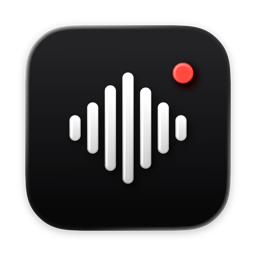

<picture>
  <source media="(prefers-color-scheme: dark)" srcset="assets/hero-dark.png">
  
</picture>

  
  

 

<a href="https://apps.apple.com/fr/app/facilabo-de-230-calendriers/id6756318719">
<picture>
  <source media="(prefers-color-scheme: dark)" srcset="assets/fa-dark.png">
  
</picture>
</a>

Public holidays, school breaks, tax deadlines, exams, sport, festivals, for France, Belgium, Switzerland, Luxembourg and Canada. Subscribe once, it stays up to date in your iPhone, Google or Outlook calendar. 
<a href="https://apps.apple.com/fr/app/facilabo-de-230-calendriers/id6756318719"><b>App Store</b></a> · <a href="https://play.google.com/store/apps/details?id=app.facilabo.android"><b>Google Play</b></a> · <a href="https://www.facilabo.com"><b>facilabo.com</b></a>

<picture>
  <source media="(prefers-color-scheme: dark)" srcset="assets/reviews-dark.png">
  
</picture>

Real App Store reviews, translated from French. <a href="https://apps.apple.com/fr/app/facilabo-de-230-calendriers/id6756318719?see-all=reviews">Read them all</a>

<a href="https://apps.apple.com/app/id6824828966">
<picture>
  <source media="(prefers-color-scheme: dark)" srcset="assets/cd-dark.png">
  
</picture>
</a>

Your Saturday picnic, still on? ClimaDay reads your calendar and gives each plan its verdict. Not in your calendar? One sentence is enough. No account, no ads, no tracking. 
<a href="https://apps.apple.com/app/id6824828966"><b>App Store</b></a> · <a href="https://climaday.app"><b>climaday.app</b></a>

<a href="https://apps.apple.com/fr/app/eurovolt-conso-%C3%A9lectricit%C3%A9/id6761270150">
<picture>
  <source media="(prefers-color-scheme: dark)" srcset="assets/ev-dark.png">
  
</picture>
</a>

Official Enedis Data Connect access, no ads, nothing to sell you, analyses kept on your iPhone. 
<a href="https://apps.apple.com/fr/app/eurovolt-conso-%C3%A9lectricit%C3%A9/id6761270150"><b>App Store</b></a> (France)

 

### Open source

| | Project | What it does |
| :---: | --- | --- |
|  | [**VoxFlow**](https://github.com/augiefra/voxflow) | Hold Fn, speak, it types. Private dictation for Mac: Voxtral and Qwen run on-device with MLX, and it learns your vocabulary from your corrections. Free, signed and notarized. |
| 🧩 | [**claude-mods**](https://github.com/augiefra/claude-mods) | One band above the Claude Code prompt: context, 5-hour and weekly limits against the clock, prompt cache countdown, session cost. |
| 📚 | [**awesome-claude-code-mods**](https://github.com/augiefra/awesome-claude-code-mods) | Every Claude Code mod on GitHub, with what each one can reach. |

If one of my tools saves you time, the nicest thank-you is to <a href="https://apps.apple.com/fr/developer/eric-cologni/id1853633356">try one of my apps</a> or leave it a review. 🙏

